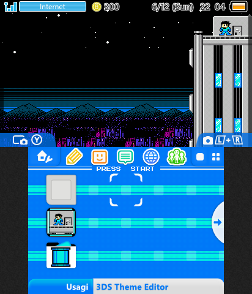
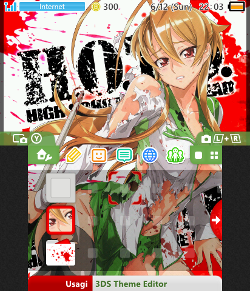
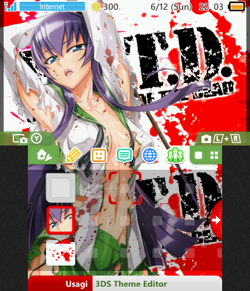
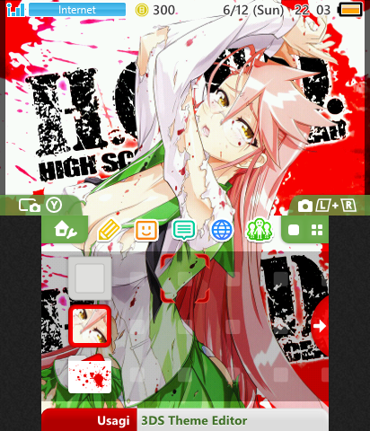
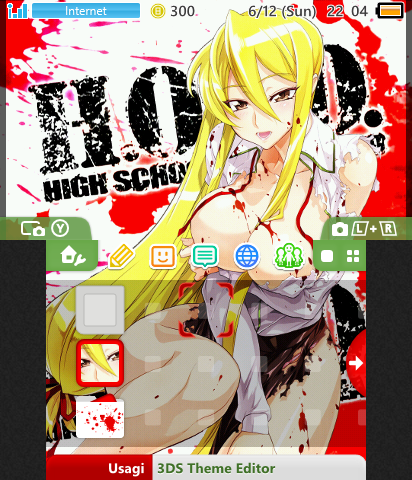

# Custom Nintendo 3DS Themes

A collection of custom themes for the Nintendo 3DS family of systems (3DS, 3DS XL, 2DS, New 3DS, New 3DS XL, New 2DS XL) running Custom Firmware (Luma3DS).

Each theme is packaged as a standard ready-to-install `.zip` archive containing the theme body (`body_LZ.bin`), background music (`bgm.bcstm` / `bgm.ogg`), SMDH metadata (`info.smdh`), and a preview image (`preview.png`). Fully compatible with **[Anemone3DS](https://github.com/astronautlevel2/Anemone3DS)** and Theme Plaza specifications.

---

## Theme Showcase

| Theme | Preview | Details & Audio | Download |
| :--- | :---: | :--- | :---: |
| **Megaman II Intro** |  | • **Theme:** NES *Mega Man 2* opening sequence<br>• **BGM:** Intro theme (looping)<br>• **Custom SFX:** Cursor, app launch, close, open, and folder actions<br>• Custom folder icons & UI badges | [Download .zip](releases/Megaman%20II%20Intro.zip) |
| **H.O.T.D. – Rei Miyamoto** |  | • **Theme:** Rei Miyamoto (*Highschool of the Dead*)<br>• **BGM:** Custom looping background music<br>• Custom top/bottom art and folder icons<br>• *Inspired by JoshMisaki* | [Download .zip](releases/H.O.T.D%20-%20Rei%20Miyamoto.zip) |
| **H.O.T.D. – Saeko Busujima** |  | • **Theme:** Saeko Busujima (*Highschool of the Dead*)<br>• **BGM:** Custom looping background music<br>• Custom top/bottom art and folder icons<br>• *Inspired by JoshMisaki* | [Download .zip](releases/H.O.T.D%20-%20Saeko%20Busujima.zip) |
| **H.O.T.D. – Saya Takagi** |  | • **Theme:** Saya Takagi (*Highschool of the Dead*)<br>• **BGM:** Custom looping background music<br>• Custom top/bottom art and folder icons<br>• *Inspired by JoshMisaki* | [Download .zip](releases/H.O.T.D%20-%20Saya%20Takagi.zip) |
| **H.O.T.D. – Shizuka Marikawa** |  | • **Theme:** Shizuka Marikawa (*Highschool of the Dead*)<br>• **BGM:** Custom looping background music<br>• Custom top/bottom art and folder icons<br>• *Inspired by JoshMisaki* | [Download .zip](releases/H.O.T.D%20-%20Shizuka%20Marikawa.zip) |

---

## Installation via Anemone3DS

1. Ensure your console has custom firmware installed (such as **Luma3DS**).
2. Download the desired theme `.zip` file from the [`releases/`](releases/) folder.
3. Place the `.zip` file directly onto your 3DS SD card in the `Themes` folder:
   ```text
   SD:/Themes/<ThemeName>.zip
   ```
4. Insert the SD card back into your 3DS and launch **Anemone3DS**.
5. Find the theme in the list and hold **A** to install it to your HOME Menu, or press **Y** to add it to your shuffle pool.

---

## Project Structure

```text
Game_Mod_3DS-Themes/
├── previews/                 # Rendered theme preview mockups (used in README)
│   ├── megaman-2-intro.png
│   ├── hotd-rei-miyamoto.png
│   ├── hotd-saeko-busujima.png
│   ├── hotd-saya-takagi.png
│   └── hotd-shizuka-marikawa.png
├── releases/                 # Ready-to-use theme packages (.zip) for Anemone3DS
│   ├── Megaman II Intro.zip
│   ├── H.O.T.D - Rei Miyamoto.zip
│   ├── H.O.T.D - Saeko Busujima.zip
│   ├── H.O.T.D - Saya Takagi.zip
│   └── H.O.T.D - Shizuka Marikawa.zip
└── src/                      # Source materials for editing / customizing
    ├── notes.txt             # Audio conversion specs, limits & mixing notes
    ├── megaman-2-intro/      # GIMP .xcf files, individual WAV and BCWAV sound effects
    └── hotd/                 # GIMP .xcf layouts, high-quality WAV audio loops
        ├── rei-miyamoto/
        ├── saeko-busujima/
        ├── saya-takagi/
        └── shizuka-marikawa/
```

> **Editing Source Files:** Source images are provided in GIMP format (`.xcf`). Source sound files are provided as `.wav` along with converted `.bcwav` cue files. Theme archives can be rebuilt or modified using tools like [Usagi 3DS Theme Editor](https://github.com/Ryuzaki-MrL/Usagi) or [YATA+ / Kame-Editor](https://github.com/exelix11/YATA-PLUS). For sample rate caps, file size limits, and volume mixing rules, see [`src/notes.txt`](src/notes.txt).

---

## Disclaimer & Credits

* **Disclaimer:** This is an unofficial, non-commercial fan project created for personal use on homebrew-enabled Nintendo 3DS consoles.
* **Intellectual Property:** All characters, music, and trademarks remain the intellectual property of their respective owners:
  * *Mega Man* © Capcom Co., Ltd.
  * *Highschool of the Dead* © Daisuke Satō / Shōji Satō / Kadokawa Shoten / Madhouse.
  * *Nintendo 3DS* and system software © Nintendo Co., Ltd.
* **Credits:**
  * Theme compilation and audio/visual adaptations by **Fooly Cooly**.
  * Highschool of the Dead themes inspired by **JoshMisaki**.
* **License:** Original compilation and modifications are released under [The Unlicense](LICENSE).
